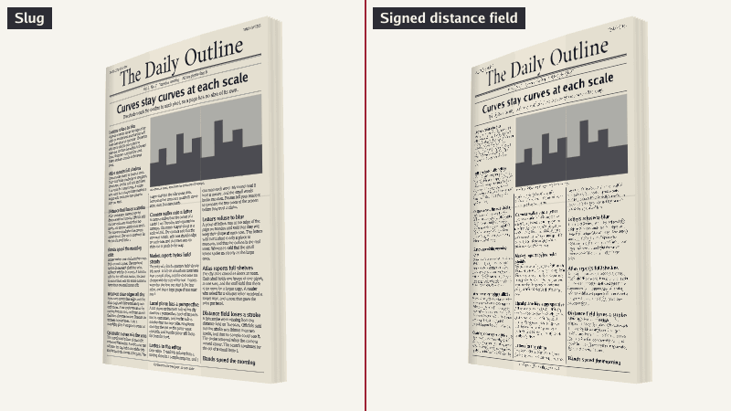

# go-slug

[](https://pkg.go.dev/github.com/dhannyell/go-slug)
[](https://github.com/dhannyell/go-slug/actions/workflows/test.yml)
[](LICENSE)

go-slug is a Go library that prepares vector outlines (font glyphs, icons and shapes)
for GPU rendering with the [Slug](https://jcgt.org/published/0006/02/02/) algorithm.
The shader reads the outline in each pixel, so text stays sharp at each scale and
angle, without a texture atlas.

[](https://dhannyell.github.io/go-slug/?scene=news&mode=versus-sdf)

**[Run this demo in your browser](https://dhannyell.github.io/go-slug/?scene=news&mode=versus-sdf)**:
a drag turns the newspaper, and the wheel zooms. The demo needs a browser with WebGPU.

> [!NOTE]
> The API can change before v1.0.0.

## Contents

- [Features](#features)
- [Install](#install)
- [Quick start](#quick-start)
- [Draw on the GPU](#draw-on-the-gpu)
- [Shape text](#shape-text)
- [Compare with other methods](#compare-with-other-methods)
- [Limits in 3D](#limits-in-3d)
- [Samples](#samples)
- [Documentation](#documentation)
- [Credits](#credits)
- [License](#license)

## Features

- **No graphics API dependency.** The library produces data buffers and WGSL code
  that any WebGPU host can use.
- **Fonts, icons and shapes.** A `Drawing` has layers of filled paths, with fill rules,
  transforms and solid colors. The `font` package reads TrueType and OpenType glyphs.
- **Exact perspective.** A plane in 3D needs only its matrix.
- **Incremental upload.** A `Pack` only grows, and `TakeDirty` tells which data is new.
- **Cache on disk.** `Pack.Encode` and `Decode` store the data in a
  [versioned format](FORMAT.md).
- **CPU copy of the shader.** `Pack.Rasterize` draws without a GPU. The tests use it as
  the oracle of the WGSL code.
- **Optional text shaping.** The [`text`](text) module adds kerning, ligatures,
  right-to-left text and line breaks.

## Install

The library needs Go 1.25 or later.

```bash
go get github.com/dhannyell/go-slug
```

## Quick start

This program puts glyphs in a `Pack` and draws them with the CPU. It writes
`curves.png`. It uses the Go fonts as its font data.

```go
package main

import (
	"image"
	"image/draw"
	"image/png"
	"log"
	"os"

	"golang.org/x/image/font/gofont/goregular"

	"github.com/dhannyell/go-slug"
	"github.com/dhannyell/go-slug/font"
)

func main() {
	f, err := font.Parse(goregular.TTF)
	if err != nil {
		log.Fatal(err)
	}
	dst := image.NewRGBA(image.Rect(0, 0, 400, 100))
	draw.Draw(dst, dst.Bounds(), image.White, image.Point{}, draw.Src)

	var pack slug.Pack
	const size = 64 // pixels per em
	x := float32(16)
	for _, r := range "Curves" {
		id, err := f.GlyphIndex(r)
		if err != nil {
			log.Fatal(err)
		}
		g, err := f.Glyph(id)
		if err != nil {
			log.Fatal(err)
		}
		entry, err := pack.Add(slug.Key{ID: uint32(id)}, g.Drawing)
		if err != nil {
			log.Fatal(err)
		}
		// The matrix goes from em space, Y-up, to pixels, Y-down.
		view := slug.Affine{size, 0, 0, -size, x, 72}
		black := [4]float32{0, 0, 0, 1}
		if err := pack.Rasterize(entry, view, black, dst); err != nil {
			log.Fatal(err)
		}
		x += g.Advance / float32(f.UnitsPerEm()) * size
	}

	out, err := os.Create("curves.png")
	if err != nil {
		log.Fatal(err)
	}
	defer out.Close()
	if err := png.Encode(out, dst); err != nil {
		log.Fatal(err)
	}
}
```

## Draw on the GPU

`slug.ReferenceWGSL` is a complete shader. A host must do these steps:

1. Upload `Pack.Curves`, `Pack.Bands` and `Pack.Layers` as three storage buffers.
2. Bind the uniform and the buffers:

   | Binding | Data |
   | --- | --- |
   | 0 | `clip_from_world` as a `mat4x4f`, then the viewport in pixels as a `vec2f` |
   | 1 | `Pack.Curves` |
   | 2 | `Pack.Bands` |
   | 3 | `Pack.Layers` |

3. Give one instance for each layer of an `Entry`:

   | Location | Type | Data |
   | --- | --- | --- |
   | 0 | `vec4f` | values a, b, c and d of the `Affine` from em space to world space |
   | 1 | `vec2f` | values e and f of the `Affine` |
   | 2 | `vec4f` | the color of a `CurrentColor` layer: straight RGB, in sRGB |
   | 3 | `u32` | `Entry.FirstLayer` plus the index of the layer |

4. Draw 6 vertices per instance, as a triangle list.
5. Blend with `One` and `OneMinusSrcAlpha`, into a target without an sRGB view.

`slug.CoreWGSL` holds only the functions, for a shader of your own. It calls
`slug_curve`, `slug_band` and `slug_layer`, which you declare. [FORMAT.md](FORMAT.md)
describes the data. [samples/internal/render](samples/internal/render) is a complete
host.

## Shape text

> [!NOTE]
> The `font` package maps one rune to one glyph. For kerning, ligatures and
> right-to-left text, use the `text` module.

[`text`](text) is a separate module, because it depends on
[go-text/typesetting](https://github.com/go-text/typesetting), and the core needs no
shaper.

```go
f, err := text.Parse(fontData, 0)
for _, line := range f.Shape("office", text.Options{}) {
	for _, g := range line.Glyphs {
		entry, err := f.Add(&pack, g)
		// Draw entry with g.At(size), then move by the baseline of the line.
	}
}
```

`Shape` uses one font for all of the string. A font fallback is the work of the caller.

## Compare with other methods

The `news` demo draws the same image twice: Slug on the left, and a traditional method
on the right. The sizes below come from this scene.

| | Slug | Bitmap atlas | Signed distance field |
| --- | --- | --- | --- |
| Data | 75 KB | 75 KB | 298 KB, 66 texels per em |
| Small text, 10 pixels per em | sharp | readable | loses strokes |
| Text near the camera | sharp | blurred | good, with round corners |
| GPU time | the most in `news` | the least, except when the camera is near | about the same as Slug in `hall`, more when the camera is near |

Read this table with these conditions:

- The first view of the demo keeps the body text at 10 pixels per em. This is the size
  where one shared distance field fails, so the view is the best case for Slug. From
  about 14 pixels per em, the field reads well. An application could also give body
  text its own atlas.
- The distance field has one channel, so it is not the multichannel form, which keeps
  corners better. It uses a cubic filter, which costs more texture reads.
- In `news`, the shader of Slug also draws the paper of all the sheets. The GPU time is
  from one GPU, so measure on your target.

The demo has the two methods:

- [Slug and a signed distance field](https://dhannyell.github.io/go-slug/?scene=news&mode=versus-sdf)
- [Slug and a bitmap atlas with mipmaps](https://dhannyell.github.io/go-slug/?scene=news&mode=versus)

## Limits in 3D

An application that draws planes in 3D must obey these limits:

- **Draw planes from the back to the front.** A depth buffer would let an antialiased
  edge hide what is behind it.
- **Keep each item away from the camera plane.** The shader divides by the w of a
  vertex. Remove a plane before a corner of it gets near the camera plane.
- **Do not draw a plane near its edge.** There, one pixel covers a large part of the
  em, so coverage leaks past the corners of the plane along the edge. The `hall` scene
  removes a turning plane when the cosine to the camera is less than 0.03.

## Samples

[samples](samples) is a separate module, so the library has no GPU dependency. Run the
scenes in a browser, or with these commands in the `samples` directory.

Draw the scenes in a window:

```bash
go run ./cmd/native
```

Build the browser host:

```bash
CGO_ENABLED=0 GOOS=js GOARCH=wasm go build -o web/app.wasm ./cmd/web && cp "$(go env GOROOT)/lib/wasm/wasm_exec.js" web/
```

Serve it at `http://localhost:8092`:

```bash
go run ./cmd/serve
```

In a window, the keys select the scenes and the views. In a browser, the address does.

| Key | Scene | Shows |
| --- | --- | --- |
| 1 | [`overview`](https://dhannyell.github.io/go-slug/?scene=overview) | text, transforms, fill rules and layers |
| 2 | [`zoom`](https://dhannyell.github.io/go-slug/?scene=zoom) | a continuous zoom, up to 256 times |
| 3 | [`perspective`](https://dhannyell.github.io/go-slug/?scene=perspective) | a plane that turns in perspective |
| 4 | [`text`](https://dhannyell.github.io/go-slug/?scene=text) | ligatures, Arabic, mixed directions and line breaks |
| 5 | [`hall`](https://dhannyell.github.io/go-slug/?scene=hall) | a walk in 3D: text on the floor, signs on the walls and a turning cube |
| 6 | [`dive`](https://dhannyell.github.io/go-slug/?scene=dive) | a camera that goes from a whole word to one corner of a letter |
| 7 | [`news`](https://dhannyell.github.io/go-slug/?scene=news) | a folded newspaper, full of small text: a drag turns it, and the wheel zooms |

| Key | Address | Shows |
| --- | --- | --- |
| D | `mode=debug` | the curves in each band, the band borders and the control points |
| C | `mode=compare` | the GPU, the CPU, their difference and the pixels over the tolerance |
| V | `mode=versus` | in `hall`, `dive` and `news`: Slug and a bitmap atlas with mipmaps |
| F | `mode=versus-sdf` | in `hall`, `dive` and `news`: Slug and a signed distance field |

In a browser, `budget=16` gives a versus atlas 16 times the bytes of the Slug data.

## Documentation

- [API reference](https://pkg.go.dev/github.com/dhannyell/go-slug)
- [FORMAT.md](FORMAT.md): the GPU arrays and the bytes of `Pack.Encode`

## Credits

The rendering algorithm is Slug, by Eric Lengyel:

- Eric Lengyel, "GPU-Centered Font Rendering Directly from Glyph Outlines",
  *Journal of Computer Graphics Techniques*, vol. 6, no. 2, 2017.
  <https://jcgt.org/published/0006/02/02/>
- Reference shaders: <https://github.com/EricLengyel/Slug>

The WGSL shaders and the CPU coverage evaluator in this repository derive from the
reference shaders. Slug shader code Copyright 2017 by Eric Lengyel, used under the MIT
License (see [LICENSES/Slug-MIT.txt](LICENSES/Slug-MIT.txt)). The Slug patent has been
dedicated to the public domain.

The `text` scene uses the Amiri font, under the SIL Open Font License (see
[samples/internal/scene/fonts/OFL.txt](samples/internal/scene/fonts/OFL.txt)).

## License

go-slug is available under the MIT License. See [LICENSE](LICENSE) and
[NOTICE](NOTICE).
